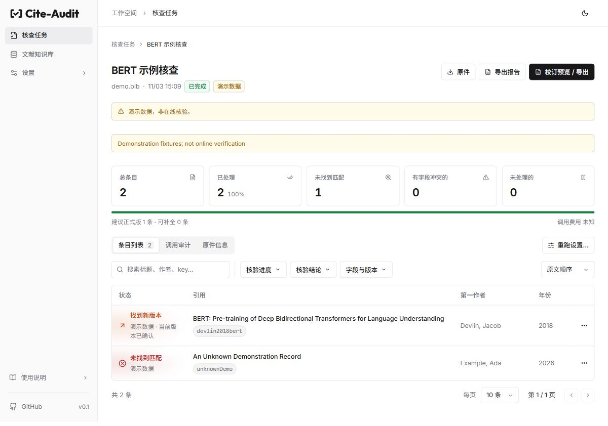
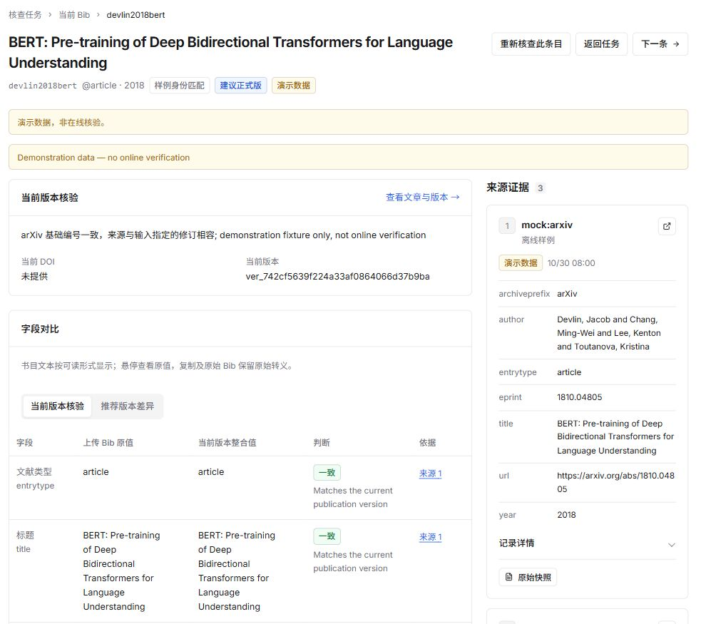
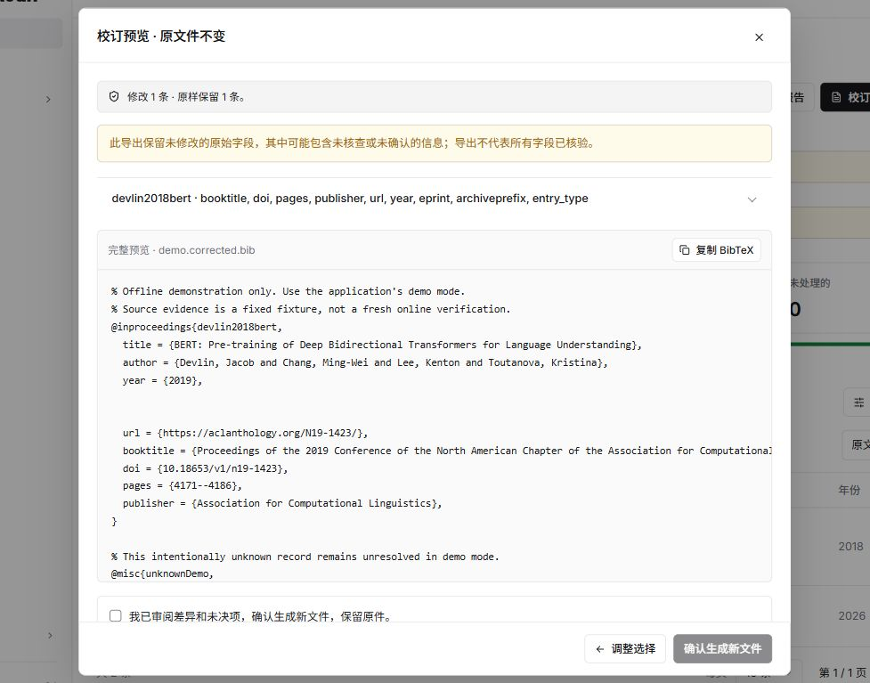

# Cite Audit

> [!WARNING]
> **Cite Audit 不能替代人工核验。** 核查完成后，建议逐条审阅结果及其来源证据，经人工复核后手工修改引用。
>
> **数据源的覆盖并不完整，记录也可能存在缺漏或错误。** 检索未命中不代表文献不存在，核查通过也不保证所有书目信息准确。

**从一份 BibTeX 文件，追溯每条引用的版本、字段与来源证据。**

Cite Audit 面向论文作者：上传 `.bib`，核查当前引用的出版版本，查看字段差异和正式发表版本建议，再按自己的选择导出新的校订文件与变更清单。上传原件始终保留。

这是一个使用 **Python / FastAPI、React / TypeScript 和 SQLite** 的本地单用户应用。当前版本为 `0.1.0`。

[快速启动](#快速启动) · [使用流程](#使用流程) · [支持的来源](#支持的来源) · [开发与验证](#开发与验证)

## 主要功能

- **批量核查与筛选**：按文件建立独立任务，查看进度、核查结论、字段冲突与版本建议；支持取消、单条重查及按结果或所选条目重跑。
- **区分当前版与推荐版**：先核验输入所指向的具体出版版本，再单独比较正式版。准确的预印本与正式版建议可以同时成立。
- **从字段追溯到证据**：查看逐字段对照、候选记录、来源快照与调用详情，保留身份歧义、证据不足、来源失败及预算耗尽等原因。
- **预览后安全导出**：同版本修正可逐字段选择；切换版本采用完整提案，避免拼接不同版本。未选条目保留原样，生成新 Bib 和变更清单。
- **保留历史与知识**：文献知识库按“文章 → 出版版本 → 来源内容”组织；每轮完成报告冻结其实际证据和规则修订，导出选择不会改写共享事实。演示与在线数据分开保存和展示。

## 界面预览

任务详情集中展示处理进度、待关注条目、筛选与导出入口。



<details>
<summary>查看字段与来源证据（局部截图）</summary>

字段对照与来源记录并列展示；“当前版本核验”和“推荐版本差异”分别查看。



</details>

<details>
<summary>查看校订导出预览（局部截图）</summary>

先审阅变更范围与完整 Bib，再确认生成新文件。预览会提示仍然保留的未核查信息。



</details>

以上为当前界面使用 [demo.bib](docs/examples/demo.bib) 的离线演示截图，**非在线核验结果**。截图采集说明见 [docs/images/README.md](docs/images/README.md)。

## 快速启动

需要 **Python 3.12+、uv 和 Node.js 22.12+**。在仓库根目录执行：

```sh
uv sync --locked
cd frontend
npm ci
npm run build
cd ..
uv run --locked cite-audit
```

打开 [http://127.0.0.1:8000](http://127.0.0.1:8000)。前端构建产物由后端一并提供，日常使用只需启动一个服务。

指定端口与数据目录：

```sh
uv run --locked cite-audit --port 8000 --data-dir ./local-data
```

也可通过 `CITE_AUDIT_DATA_DIR` 设置数据目录；默认是启动目录下的 `.cite-audit-data`。长期使用建议指定绝对路径，避免切换工作目录后打开另一份数据库。更新代码和前端构建后，重启后端并刷新页面。

## 使用流程

1. **先体验离线演示。** 上传 [docs/examples/demo.bib](docs/examples/demo.bib)，选择“演示模式”。BERT 样例展示预印本与正式版关系，另一条未知记录保留未决状态。演示只使用固定样例，不会为任意文献生成证据。
2. **配置在线来源。** 在“设置 → 数据源”选择并保存要使用的来源，按需填写凭据、测试连接；在执行设置中调整请求预算和超时。
3. **上传自己的 Bib。** 选择在线模式创建任务。每次上传都是独立任务，相同文件也不会覆盖历史报告。在线检索会向启用的外部服务发送题名、作者或标识符等书目信息，上传前请确认可以用于外部检索。
4. **查看结果与依据。** 在任务详情筛选需要关注的条目，进入引用详情检查当前版本、字段依据与推荐版本差异。未命中、访问失败或证据不足都不能据此认定论文不存在。
5. **预览并导出。** 点击“校订预览 / 导出”，选择同版本修正或整体改用推荐版本，审阅差异后生成新 Bib 与变更清单。原件与各轮报告可分别下载。

任务结束后，可在引用详情重查单条，也可通过任务页的“重跑设置”按核查结果、手动选择或全部条目重新核查。重查沿用当前任务，保留历史报告和既有导出；单条重查保留其他条目的结果。

## 支持的来源

来源按输入中的标识符、题名和出版信息选择适用的查询方式。下表说明当前适配范围，不代表全库覆盖或实时连接承诺。

| 来源 | 主要用途与范围 |
| --- | --- |
| Crossref | DOI 登记记录、题名候选及按 ISSN 核对期刊名称 |
| arXiv | 预印本标识与修订信息，跟进记录中的正式出版 DOI |
| OpenAlex、Semantic Scholar | 按标识或题名发现候选，提供出版线索；可配置 API key |
| ACL Anthology | 官方论文标识，以及 ACL / EMNLP / NAACL 对应年份目录 |
| PMLR | 官方论文标识或卷号；ICML 可按年份定位论文集 |
| ICLR Proceedings、NeurIPS Proceedings、COLM | 根据官方链接或会场、年份与题名定位会议版本 |
| OpenReview、TMLR | 按 OpenReview 论坛标识查询；TMLR 也可按期刊名和题名定位，并核对官方 BibTeX；OpenReview 可配置 token |
| DataCite / Hugging Face | 输入含 `10.57967/hf/` 模型 DOI 时核对模型登记信息 |
| 中国知网（可选） | 通过本机浏览器按含汉字的中文题名检索候选与 BibTeX，默认关闭 |

来源的覆盖、配额、凭据与访问策略不同。连接测试会发起真实请求；某条样例可访问，不代表所有条目都能核实。在线任务不会在来源失败后自动降级为演示证据。请求预算按实际请求尝试计数，重试和重定向也占额度。

<details>
<summary>启用中国知网</summary>

安装可选依赖：

```sh
uv sync --locked --extra cnki
```

Windows 使用系统 Edge；其他平台还需安装 Chromium：

```sh
uv run --locked --extra cnki playwright install chromium
```

在具备桌面会话的服务主机上开启“设置 → 数据源 → 中国知网”。程序打开独立浏览器，遇到安全验证时等待你在该窗口手动完成，再继续查询。同一服务复用知网页签及验证状态，但知网仍可能再次要求验证。纯英文题名会跳过；连续检索带有等待间隔。可关闭知网窗口结束本次查询，或在任务页取消核查。

</details>

### 模型功能的当前范围

模型默认关闭。目前提供 MMSP 模型配置、目录价格、显式连接测试与调用审计，**尚未接入任务中的检索规划、候选消歧或网页抽取**。配置模型不代表核查任务会使用模型，模型输出也不是书目证据。

模型连接测试需要显式确认，可能产生费用。未知用量或价格显示为“未知”；目录价格用于估算，不等于服务商账单。

## 数据与使用边界

- **本地单用户运行。** 默认仅监听 `127.0.0.1`，没有账号认证和多人隔离，不应直接把端口暴露到公网。
- **保护数据目录。** 其中保存原始上传、来源快照、报告、导出和后端配置。密钥不通过读取接口返回，响应与调用记录进行脱敏；本地 SQLite 本身未加密，请保护目录和备份，勿提交或公开。
- **完整备份。** 停止应用后备份整个数据目录，避免多个进程同时处理同一目录。任务删除、查询缓存清理与共享知识保留的具体范围见 [运行说明](docs/OPERATIONS.md)。
- **核查有证据边界。** 确认论文身份或出版版本不代表所有字段正确；来源缺失时保留未核实状态。辅助字段可能原样进入导出，导出文件不代表每个字段都已核验。详见 [字段规则](docs/semantic-fields.md)。
- **独立实现。** 本项目按仓库中的 v3 设计实现，不提供旧版数据库迁移或旧 API 兼容。

## 开发与验证

开发时保持后端运行，在另一终端启动前端热更新：

```sh
cd frontend
npm run dev -- --host 127.0.0.1
```

Vite 将 `/api` 转发到 `127.0.0.1:8000`。项目结构：

```text
cite_audit/       后端 API、核查流程、来源适配与持久化
frontend/        React 界面与交互测试
tests/           后端行为与领域规则测试
docs/            操作说明、设计、证据规则与验证记录
scripts/         安装包与专项验证工具
```

按改动范围运行相关检查；文档或截图修改只需检查差异与链接。下面列出完整验证入口，日常修改无需全部运行：

```sh
uv run --locked pytest
uv run --locked ruff check cite_audit tests scripts
cd frontend
npm test
npm run build
cd ..
uv build --wheel
uv run --locked python scripts/check_wheel.py dist
```

前端构建包含 TypeScript 检查；也可单独运行 `npm run typecheck`。前端 API 交互测试使用独立临时后端与 SQLite；wheel 检查从源码目录之外验证安装后的资源、接口、冻结报告与导出。它们使用离线数据，不证明真实来源准确率或实时可用性。

源码开发使用 `uv.lock` 与 `frontend/package-lock.json`。分发 wheel 前先构建前端，安装和备份说明见 [OPERATIONS.md](docs/OPERATIONS.md)。CI 定义见 [test.yml](.github/workflows/test.yml)，实际测试结论以对应提交的运行结果为准。

## 更多文档

- [本地运行、安装包与故障排查](docs/OPERATIONS.md)
- [验证记录与各轮验收范围](docs/VALIDATION.md)
- [API 契约](docs/api-contract.md)；运行时接口文档位于 [http://127.0.0.1:8000/docs](http://127.0.0.1:8000/docs)
- [字段语义与导出边界](docs/semantic-fields.md)
- [候选筛选、身份匹配与验证记录](docs/identity-validation.md)
- [产品设计与领域约束](docs/design/DOMAIN_CONTRACT.md)

设计文档描述产品目标，验证记录描述特定修订的检查结果；两者均不替代当前版本的实际验收。
