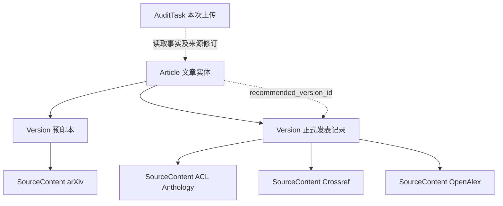

# Cite-Audit · 全新实现开发说明

版本 3.0 · 2026-10-30 · **Greenfield Remake / 仅设计交接**

> **目标**：论文作者上传一份完整的 `.bib`，系统检索并核验其中的全部引用，发现身份冲突、字段错误和更合适的正式发表版本；每条建议附来源证据。作者审阅差异并导出一份**新的**校订 Bib，不修改原文件。重复上传只是一项新任务，共享知识库积累的来源事实以减少重复检索。

**实施边界已确定**：这是一次从零实现的 remake。不得将历史版本的 React 页面、Python 代码、数据库、API、缓存格式、任务状态、配置或 UI 流程作为依赖；**没有旧数据迁移、旧 API 兼容、旧代码复用及过渡界面的任务**。可使用通用开源第三方依赖和标准开发工具。设计资料和图片用于明确目标，不是复用旧实现的授权。本文也不是已完成实现或真实在线接口验收的声明。

产品原则见 [`product/PRODUCT_DESIGN_v3.0.md`](product/PRODUCT_DESIGN_v3.0.md)，数据不变量见 [`DOMAIN_CONTRACT.md`](DOMAIN_CONTRACT.md)，页面与视觉细节见 [`UI_GUIDE.md`](UI_GUIDE.md)。

## 1. 要交付的产品

作者的操作路径固定为：**任务列表 → 上传 Bib → 单次任务详情 → 引用核查详情 → 查看证据和建议 → 校订预览 / 导出新 Bib**。文献知识库是平行的可查看入口，用于展示系统积累的文章、版本及来源，不参与作者的任务处理状态管理。

| 业务单元 | 核心职责 | 本轮必需产物 |
| --- | --- | --- |
| 核查任务管理 | 以每次 Bib 上传为独立任务，组织全部条目、进度、历史报告及文件导出 | 任务列表、任务详情、完整进度及结果报告 |
| 引用核查 | 识别当前条目对应的文章及版本，核对字段与标识符，明确未决与失败 | 当前版本核验结果、字段对照、证据链 |
| 书目校订 | 当前版本纠错 / 补全与**整体切换推荐版本**两种建议分开 | 建议 BibTeX、差异预览、显式确认、导出新文件 |
| 文献知识库 | 保存**文章 → 版本 → 源内容**，归并同版本不同来源，并维护推荐版本 | 去重与合并、字段来源、版本关系、推荐指针 |
| 运行支撑 | 来源适配、缓存、任务执行、模型辅助、调用记录和访问控制 | 可靠请求控制、可追踪失败与预算、设置页面 |

不做正文论断支持性验证、论文推荐、全文下载/阅读系统、多人协作、独立“修订复查”模块。作者再次上传即可新建任务；**不继承之前的核查通过结论或作者选择**。

## 2. 从零搭建的系统结构

建议首版采用单实例本地 Web 应用（不是微服务），技术栈可按下列契约独立选型：

- **前端**：React + TypeScript + Vite；shadcn/ui + Tailwind CSS 的简洁管理后台风格；React Router 管理页面，TanStack Table 管理复杂表格，TanStack Query 管理请求与状态（均为可选第三方依赖，不得引入无关 CMS 系统）。
- **后端**：Python 3.12+、FastAPI、Pydantic、`httpx`。采用 `uv` 管理 Python 依赖，提交 `pyproject.toml` 与 `uv.lock`。可使用成熟的 BibTeX 解析库，但必须针对宏、跨条目引用、注释和原始字节保真作测试。
- **持久化**：新建 SQLite 数据库（单实例、WAL、事务）及按内容寻址的原始来源快照；数据迁移仅指未来新版本的 schema 演进，不是旧产品数据迁移。
- **执行**：持久任务队列、按 Provider 限流及有界重试；不需要在首版引入 Redis、Celery、向量数据库或独立搜索服务。
- **模型**：可配置兼容调用适配器，辅助检索策略、相似候选消歧、网页抽取与解释；**事实性结论必须落到来源记录**。模型调用与非模型来源调用统一记录成本和失败情况。

建议代码按实际职责拆成 `bib/`、`audit/`、`bibliography/`、`sources/`、`tasks/`、`export/`、`api/`、`web/` 等少数清晰模块；这些是目标目录建议，不是任何历史路径的对应关系。避免过度封装和一个页面组件承载全部业务。

## 3. 数据模型：任务与文献知识分离

### 3.1 任务数据

`AuditTask` 保存本次任务 ID、文件名、原始文件哈希及不可变字节、创建时间、任务参数、执行状态与结果摘要；`TaskEntry` 保存本次 Bib 的一个条目及解析状态、原 citation key、原文、字段和核查结果。`FieldAssessment` 明确原值、当前版本对照值、判断、证据、理由；`CorrectionProposal` 记录可安全采用的字段修改或**整体**发表版本替换；`ExportPlan/ExportArtifact` 保留作者在**本任务**中的导出选择、生成文件哈希和差异清单。

每次上传产生全新 `AuditTask`，包括相同文件。旧任务不能提供新任务的“已核实”结论；仅可共享知识库中的**来源事实及其有依据的整合**。本任务输入中未经证实的字段不能回写为知识库真值。

### 3.2 文献知识库：三层业务对象

- `Article`：研究成果的主轴，关联已知版本、文章身份依据、`recommended_version_id` 和推荐规则修订。推荐可以为空。
- `PublicationVersion`：一份可辨认的出版记录，如具体预印本、正式会议版或期刊版。保存该版本**整合后的字段**、版本标识符、字段冲突、各字段来源及整合修订。
- `SourceContent`：某个来源描述某出版记录的原始内容及提取字段，带来源/源 ID/URL/时间/状态/快照。不同来源对同版本的记载都留在该版本之下。

数据库可以增加关联表、来源快照表、字段值表、推荐修订表和候选暂存表，但逻辑上**始终保持这三个业务层次**。关联与字段整合必须留可追溯依据；来源内容不能被 merge 后覆盖。候选不确定时留在 staging 状态，不伪造成“已确认的文章/版本”。

### 3.3 三条不可违反的规则

1. **同一版本多来源归并**：先用经验证的 DOI/官方记录标识、作者标题、出版信息联合确定“同一出版记录”，再合并同义表达、互补字段和冲突。细微差异或字段缺失不创造新版本；已确认同一记录的冲突不靠拆版本逃避。
2. **不同版本不合并字段**：预印本与正式版可以归属于同一个 Article，但不能将预印本 DOI、会议 booktitle、另一个版本的年份拼成一条引用。切换推荐版本必须按整体版本生成 Bib。
3. **推荐的是版本**：文章的默认推荐直接指向一个已确认的 `PublicationVersion`，不再复制一份推荐“超级记录”；它由来源与规则推导，不受作者某次导出选择影响。

具体对象字段、归并记录及决策状态见 [`DOMAIN_CONTRACT.md`](DOMAIN_CONTRACT.md)。

## 4. 一次完整核查如何执行

1. **解析原文件**：保存不可变字节；解析宏、条目、字段、跨条目引用、重复 key 和错误位置。任何损坏条目都必须给出结果，不能静默消失。
2. **身份线索提取**：从原 Bib 提取 DOI、arXiv ID、题名、作者、出处、年份；保留原值与用于比较的规范形式，原值不被无条件替换。
3. **知识匹配**：先匹配已有 SourceContent/Version/Article 及证据有效期。命中并不代表该任务“通过”；要确定**本次输入**与知识的对应关系。
4. **定向补充检索**：证据不足或正式发表信息可能更新时，按标识符精确查、标题作者候选查、官方论文集确认的顺序检索；预算、限流、网络失败独立记录。
5. **写入来源与归属**：每条成功获取的来源记录先持久保存原始快照，再根据身份依据归入已有版本或留为待确认候选；随有充分证据的字段更新版本整合结果，并必要时更新推荐指针。
6. **核验当前引用版本**：判断当前输入具体指向哪一版本，然后核验其字段。原本准确的 arXiv 引用不得因为推荐的是会议版而被判年份错误。
7. **生成两类建议**：① 当前版本字段纠错/补全；② 对于确证可替代关系，提供**一份**推荐版本的整体引用建议。保留“当前有效，建议升级”的复合结论。
8. **固定本次结果**：单条与整库报告绑定使用的来源快照 ID、整合修订及规则版本。之后知识库更新不静默修改历史报告。
9. **可选择导出**：作者在本次任务中选择明确的建议，预览更改与未决条目，确认后下载**新 Bib 文件**及差异清单。

## 5. 数据源与权威出版记录

应采用统一的 `SourceAdapter` 接口，但**允许不同来源能力不同**：`lookup(identifier)`、`search(query)`、`fetch_publication(id)`、`sync_index()` 分别声明支持状况，不强迫所有 Provider 暴露假接口。来源类型区分 DOI 注册机构、预印本平台、官方论文集、学术聚合检索、人工资料线索。

| 阶段 | 来源 | 作用 |
| --- | --- | --- |
| 基础接入 | Crossref、arXiv、OpenAlex、Semantic Scholar | DOI/预印本、候选发现、版本线索和来源追溯 |
| 官方论文集样板 | ACL Anthology、PMLR | 按题名/作者发现官方记录，核验具体会议/卷册/页码，获取官方 BibTeX |
| 进一步扩展 | DBLP、OpenReview、NeurIPS Proceedings、CVF | 计算机领域书目、录用/出版区分和官方版本发现 |
| 可选授权 | DataCite、WoS、Scopus、Google Scholar 第三方路径、CNKI 等 | 根据授权、覆盖领域和稳定性提供补充，不作为首版强依赖 |

**不把 Google Scholar 网页采集当稳定官方 API。** 对于 OpenReview 等投稿平台，搜到 submission ≠ 正式发表；ACL Anthology 要区分 Main / Findings / Workshop。论文集数据可建本地索引，但官方检索未命中也不是“论文不存在”。所有实际 API 配额、合法使用方式及权限在实现时核对，不在设计文档里伪造已接入状态。

缓存按查询语义与时间范围设置；失败不写成“未发现”事实。仅有预印本不说明正式版发现已完成；不同来源可能共享上游记录，不按来源票数决定字段正确性。

## 6. 新 API 契约建议

下面是**全新 API 的语义轮廓**，不是旧 API 的版本号或兼容映射。实现时配套 OpenAPI/Pydantic Schema 及明确错误类型。

| 方法 / 路由（建议） | 主要响应 / 行为 |
| --- | --- |
| `POST /api/tasks` | 新建独立 Bib 核查任务、返回 task ID；不接收 parent/review 参数 |
| `GET /api/tasks`、`GET /api/tasks/{id}` | 任务列表及单个 Bib 的总体结果与状态 |
| `GET /api/tasks/{id}/entries` | 任务条目分页、搜索、事实状态和建议筛选 |
| `GET /api/tasks/{id}/entries/{entryId}` | 当前引用、当前版本核验、推荐差异、证据、原始 Bib、调用概要 |
| `GET /api/articles`、`GET /api/articles/{id}` | 以 Article 为列表对象，返回推荐版本和全部已知版本 |
| `GET /api/versions/{id}` | 某整合版本的字段/冲突/来源关联/修订依据 |
| `GET /api/sources/{id}` | 来源快照、字段原值、获取/复核时间、身份归属状态 |
| `POST /api/tasks/{id}/export-preview` | 根据本任务选择生成**无副作用**的新 Bib 预览与变更清单 |
| `POST /api/tasks/{id}/exports` | 显式确认后生成新 Bib 及更改报告，不触碰原件 |
| `GET /api/settings`、`PUT /api/settings` | 可用来源、凭据、模型、预算、超时、缓存策略 |

响应不要只返回单个笼统 `status`。至少区分 `execution`、`identity`、`field_assessments`、`publication_recommendation`，并为每个来源事实引用 `source_content_id` / `snapshot_id`。查询失败、权限不足、无结果、候选歧义和核验通过分别表达。

## 7. 安全、文件保真与调用可观测性

- **文件**：上传存储原始字节；解析使用独立表示，不执行 Bib/TeX 指令。导出按原始跨度或等效安全机制进行有依据的选择性更改，保留未修改条目、citation key、宏、注释、转义、行尾及自定义字段；无法安全定位修改时阻止该修改并解释。
- **来源**：外部 URL 受控访问，限制本地/私网/保留地址、跳转、响应大小与请求时间；来源页面只当数据，禁止执行其“指令”。
- **密钥**：仅后端存储，配置/响应/日志中脱敏，不允许提交真实密钥或作者 Bib；默认本地单用户运行，不暗示公网多用户安全。
- **任务**：持久保存且单个来源失败不阻断已完成条目；取消/重启可恢复可解释状态；每次调用含重试、预算、来源、耗时和是否缓存命中。
- **成本**：能核算的模型 usage/单价保存快照；未知成本显示“未知”，不能以 0 代替；不同货币不直接相加。
- **知识**：来源快照不可被后续 merge 覆盖；任务删除与共享知识清理是不同的明确动作；缓存清理不会改写历史证据。

## 8. 页面落地与 UI 开发

实现四个**独立全页**，不是一张展示拼图，也不是把工作台压进一个 Modal：

1. **Bib 核查任务列表**：以上传的 Bib 为每行，显著上传入口，状态仅表示执行，问题计数是结果字段。
2. **单次 Bib 任务详情**：进入指定 Bib 后展示整体进度与条目表，支持按问题筛选、查看报告和安全导出。
3. **引用核查详情**：最完整的业务页；保留当前引用、**当前版本核验/推荐版本差异两个比较上下文**、字段表、版本关系、来源证据、原始 Bib、建议 Bib、候选、查询记录和明确的操作。
4. **文献知识库**：文章列表 → 整合版本 → 同版本的来源记录；默认突出一个推荐版本，其他已知版本按需查看。

辅助设置页管理来源、模型、限流、调用记录。侧栏建议为“核查任务 / 文献知识库 / 设置”，不单列“引用核查”“书目校订”“复查”“报告”等一级空模块。完整组件、语义颜色、信息密度和自适应要求见 [`UI_GUIDE.md`](UI_GUIDE.md)。

## 9. 实施里程碑（新项目，不迁移）

| 阶段 | 可验收目标 | 不以什么代替验收 |
| --- | --- | --- |
| M1 · 基础骨架 | 新前后端、数据库、上传/解析、独立任务、原件保护、离线样例、任务列表与详情 | 静态截图代替真实任务 |
| M2 · 领域与核验 | SourceContent/Version/Article、标识符查找、身份候选、同版本 Merge、字段证据和推荐指针 | 从不同版本拼一条 Bib |
| M3 · 官方版本与 UI | ACL/PMLR 官方发现、预印本→正式版确认、四个完整页面、原文与来源追溯 | 只凭模糊标题给“已正式发表” |
| M4 · 导出与验收 | 字段和整体版本提案、安全导出新 Bib、故障恢复、真实来源实测、前后端回归、用户文档 | Mock 数据显示成真实核验 |

每个里程碑同时交付单元/集成测试、关键页面桌面截图、已验证能力与未验证能力的说明，避免等全部功能完成才发现领域模型错误。无真实 API 凭据时，优先通过显式 mock fixtures 完成离线流程；**不能**因 mock 通过而宣称已完成真实来源核验。

## 10. 必须通过的验收场景

| ID | 场景 | 期望 |
| --- | --- | --- |
| A01 | 相同 Bib 上传两次 | 独立任务 ID；当前输入分别核查；共享来源查询可复用 |
| A02 | Bib 存在宏、注释、重复 key、部分损坏条目 | 原文件不变，全部条目有去向，异常显示位置和原因 |
| A03 | DOI 真实但属于另一篇文章 | 报 DOI 归属冲突，继续用其他字段寻找原文献；不整条替换 |
| A04 | 不同来源只是大小写/会议简称不同 | 一份 Version，多条 SourceContent，不出现伪版本 |
| A05 | 同一版本不同来源提供互补字段 | Version 内有依据地补全，保留原始来源与字段映射 |
| A06 | 同一版本来源存在实质矛盾 | 保留字段冲突与依据，不靠拆版本掩盖、不盲目投票 |
| A07 | arXiv 和 ACL 会议论文属于同一研究成果 | 一个 Article、两个 Version；推荐指向可靠正式版 |
| A08 | 原 Bib 引用准确的 arXiv 版本 | 当前版本核验有效，独立展示“建议正式版”，不判预印本年份/DOI 错 |
| A09 | 只有相似标题的扩展论文 | 不自动关联为可整体替换的版本，必要时推荐为空 |
| A10 | 来源未命中、限流、失败、预算耗尽 | 分别表达，不宣称文献不存在或“已验证” |
| A11 | 作者在某次任务选择保留预印本 | 不更新知识库推荐，不影响下一次任务 |
| A12 | 版本新增来源或更新整合字段 | 保持稳定版本身份；字段证据可重算；旧任务报告不变 |
| A13 | 整库安全导出 | 原件 hash 不变，新文件及变更报告可复现；未决条目原样保留 |
| A14 | 官方会议检索 | ACL Findings/Workshop 与主会区分；OpenReview 投稿不等于录用 |
| A15 | 窄屏、深色、长题名和长 Bib 字段 | 关键内容、链接与操作仍可达，不发生关键字段被裁切 |
| A16 | 任务/知识删除与缓存清理 | 独立、明示范围，不出现无证据却显示已验证的历史结果 |

评估应报告字段级建议准确率、正确条目误报、版本误合并/误拆分、错误升级建议、候选未决率、原文保真及实际外部调用成本。性能数字只基于实际测量。

## 11. 交付定义

最终交付：全新项目代码及锁文件、明确的新数据结构与 OpenAPI、配置示例、离线 fixtures、自动化测试、真实来源测试记录、四张关键页面截图、可运行说明和导出使用说明。不提供旧系统迁移脚本、旧 API兼容端点、旧 UI 入口或依赖旧项目模块的引用。

**开发 Agent 的范围以 [`AGENT_HANDOFF.md`](AGENT_HANDOFF.md) 为准。本文只规定将来开发者该做什么，当前交付包不包含代码实施，也不代表已创建或提交 PR。**
